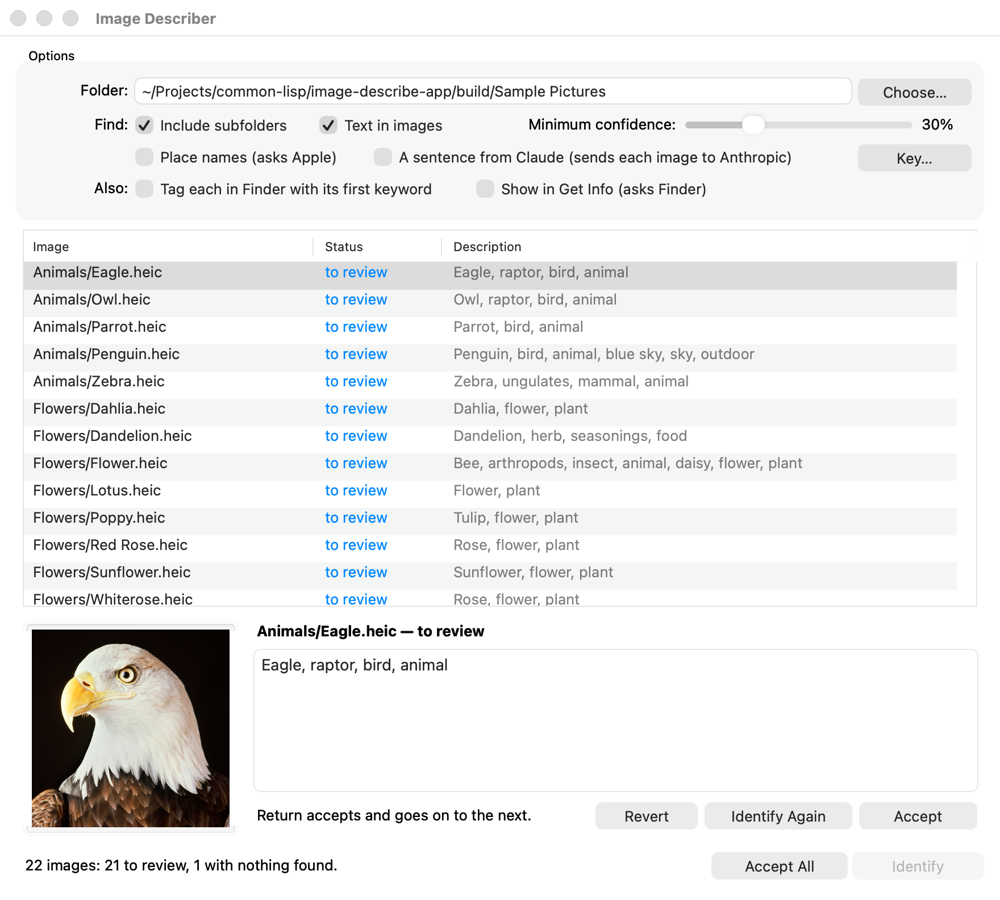

# Image Describer

A macOS application, written in Common Lisp, that says what is in each of a
folder of images and writes it onto the file, where Spotlight and Finder's
search find it. Choose a folder; Identify asks Apple's Vision framework about
every image in it, on the Mac and without a network, and proposes a
description — *Eagle, raptor, bird, animal* — which you accept as it is or edit
first. Nothing is written until it is accepted.

Built with SBCL, [objc](https://github.com/lispnik/objc) for AppKit and Vision,
[asdf-macos-app](https://github.com/lispnik/asdf-macos-app) for the bundle,
[im](https://github.com/lispnik/im) for reading the images, FiveAM for the
tests and ocicl for the dependencies. A sibling of image-converter-app, and
built the same way.



## Using it

- **Folder** — the images to describe. Choose… opens a folder panel, or type a
  path (`~` works) and press Return, or drop images or folders on the list.
  **Include subfolders** lists the images below it too; a Photos library or
  other package is not looked inside. A large folder is listed in the
  background, so the window answers while it is.
- **Identify** (⌘R) — asks Vision about every image that has no description
  yet, several at once, one per processor up to eight. Identify becomes Stop
  while it runs; Stop finishes the images in hand and starts no more, waiting
  up to two seconds for them — an image still being read after that is left
  unidentified, so a slow disk never keeps the window waiting. An image that
  already has a description — one this wrote, or a comment typed into Finder —
  is left alone unless you select it and choose **Identify Again** (⇧⌘R).

What is found, each in a short sentence of the description:

| Found | By | Example |
|---|---|---|
| What is in the image | Vision, on the Mac | *Eagle, raptor, bird, animal* |
| Cats and dogs | Vision | *Cat, animal* |
| People | Vision's face detector | *2 people* |
| When it was taken | the photograph's EXIF date | *Taken 4 July 2023* |
| Where | its GPS position, named by Apple's geocoder — **Place names**, off unless chosen | *… in Half Dome, Yosemite National Park, CA, United States* |
| Barcodes and QR codes | Vision | *Code: https://example.com* |
| Text | Vision — **Text in images** | *Text: “STOP”* |
| A sentence | Claude — **A sentence from Claude**, off unless chosen | *A bald eagle in profile against a black background.* |

**Minimum confidence** is how sure Vision must be of a label for it to be in
the description. Moving it, or turning text or places on or off, changes the
proposals at once, without identifying again; descriptions you typed or
accepted stay as they are. If nothing is that sure, the most likely thing is
still proposed, provided it has a third of the minimum.

**A sentence from Claude** sends each image, as a JPEG 1024 pixels across,
to Anthropic's API (`claude-opus-5-5`), and the sentence that comes back
leads the description. It costs about a cent an image, charged to the key's
account; **Key…** keeps an API key in your login Keychain, and
`ANTHROPIC_API_KEY`, if set, is used instead. Requests a safety classifier
declines are retried by the API on a model chosen for the reason
(`fallbacks: "default"`). Apple's own on-device model takes images only from
macOS 27, so on macOS 26 there is no way to have the sentence without sending
the image.

Select an image to see it and its description below the list. Edit the
description there and press **Return**: it is written onto the file and the
next image to review is selected, so a folder can be gone through with the
keyboard alone. **Accept** (⌘S) writes the selected images' descriptions, each
its own; **Accept All** (⇧⌘S) writes every one still to review; **Revert**
(⌘U) goes back to what the file carries, or to the proposal. An empty
description, accepted, removes the one on the file, and so does **Remove
Description**. **Undo** (⌘Z) takes back an Accept or a Remove, files and all,
and Redo does it again. Double-click an image to show it in Finder.

The Status column says where each image is: *to review* (proposed, not
written), *edited*, *saved* (the file carries what is shown), *nothing found*,
or *error* — rest the pointer on it to see why. Quitting or closing the window
with descriptions not yet accepted asks first. The options are remembered
between launches.

From Finder, too: **Open With › Image Describer** on images or a folder, a drop
on the Dock icon, or **Quick Actions › Describe with Image Describer** (once
the application is in /Applications and has been opened once).

### What is written

Extended attributes, each a binary property list, which Spotlight imports:

| Attribute | Holds |
|---|---|
| `com.apple.metadata:kMDItemFinderComment` | the description, as written |
| `com.apple.metadata:kMDItemKeywords` | the names of things in it — the comma-separated pieces of its sentences that are a few words long, and the place — but not the text read from the image, a code or a date |
| `com.apple.metadata:_kMDItemUserTags` | with **Tag each in Finder**, the first keyword as a Finder tag |
| `org.lispnik.image-describe.tags` | which of the tags this application added, so that it changes and removes only its own |

So Finder's search field, Spotlight and `mdfind` find an image by any word of
its description, and `mdfind 'kMDItemKeywords == "eagle"'` by keyword:

```sh
mdls -name kMDItemFinderComment -name kMDItemKeywords photo.jpg
mdfind -onlyin ~/Pictures eagle
```

The image itself is not changed. Finder's **Get Info** window reads comments
from the folder's `.DS_Store`, which only Finder can write safely, so it does
not show the attribute. With **Show in Get Info**, each accepted description
is also handed to Finder to set, by AppleScript; macOS asks the first time
whether Image Describer may control Finder, and if it may not, the option
turns itself off and says so.

## From a terminal

The application's own executable is a command-line program when given
arguments. `make install-cli` puts a small `image-describe` script in
`/usr/local/bin` that finds the application in /Applications.

```sh
image-describe ~/Pictures/Trip                    # what it would write, one line an image
image-describe -r --json ~/Pictures > review.jsonl
# … edit the descriptions in review.jsonl …
image-describe --apply review.jsonl               # write them
image-describe -r --accept --tags --places ~/Pictures/Trip
```

`--help` lists the rest: `--again`, `--no-text`, `--claude`,
`--min-confidence`, `--workers`. Nothing is written without `--accept` or
`--apply`. The exit status is 0, 1 if any image could not be identified or
written, and 2 for a mistake in the arguments.

## Building

You need SBCL, ocicl, the tecgraf-im libraries (`brew install
lispnik/tecgraf/tecgraf-im`), and checkouts of
[im](https://github.com/lispnik/im), which is not in the ocicl registry, and
[asdf-macos-app](https://github.com/lispnik/asdf-macos-app). By default both
are looked for beside this directory, at `../im` and `../asdf-macos-app`.

```sh
make deps         # restore the dependencies ocicl.csv pins, into ./ocicl/
make test         # the FiveAM suite
make run          # run from source, unbundled
make app          # build/Image Describer.app
make notarize     # have Apple notarise it (Developer ID; see below)
make dist         # build/Image Describer.zip, notarised, to hand out
make install-cli  # the image-describe command
make icon         # draw res/icon.png again
make screenshot   # doc/window.png, from the account pictures macOS ships
```

```sh
make app IM_DIR=~/src/im                 # im from somewhere else
make app OBJC_DIR=~/Projects/common-lisp/objc MACOS_APP_DIR=~/src/asdf-macos-app
make app MACOS_APP_DIR=                  # the asdf-macos-app ocicl.csv pins
```

The Makefile runs SBCL without your init file and with a source registry of
this tree (plus `IM_DIR`) alone, so a dependency missing from `ocicl.csv` fails
the build rather than resolving from elsewhere on your machine. The bundle
carries its own copies of IM and everything it links against, HEIF and its
codecs included, in `Contents/Frameworks`, so it runs on a Mac without
Homebrew.

### Signing and notarising

The bundle is signed ad hoc unless `MACOS_SIGNING_IDENTITY` names a
certificate; put that in `local.mk`, which is not committed:

```make
MACOS_SIGNING_IDENTITY = Developer ID Application: Your Name (TEAMID)
```

It always has the hardened runtime, with `res/entitlements.plist`: the three
entitlements an SBCL image needs, and Apple Events, for Show in Get Info.
Notarising needs credentials stored once,

```sh
xcrun notarytool store-credentials notary --apple-id you@example.com --team-id TEAMID
```

and then `make dist` builds `build/Image Describer.zip`, notarised and
stapled, which opens on any Mac without a warning (`NOTARY_PROFILE=name` for
a profile not called `notary`).

### Tests

`make test` runs about 340 checks. The ones that need Vision to name
something use the account pictures macOS ships in `/Library/User Pictures` (a
zebra, an eagle…), and skip if they are not there; those that need the window
skip without a window server. Claude's request and its error handling are
checked against a small HTTP server in the test process, so the suite needs no
key, no network, and costs nothing. The live checks are skipped unless asked
for: `IMAGE_DESCRIBE_LIVE_CLAUDE=1` (asks Anthropic about the zebra, about a
cent) and `IMAGE_DESCRIBE_LIVE_KEYCHAIN=1` (writes and removes a test item in
the login Keychain).

GitHub Actions (`.github/workflows/ci.yml`) runs the suite on a macOS runner,
builds the bundle, runs it on the account pictures from a script, and keeps
the ad hoc signed bundle as an artifact.

### Checking the bundle from a script

Besides the command line, the window has a self test: given a folder, it
identifies every image in it and its subfolders as soon as the window is up,
and quits when done, with each image's description in
`~/Library/Logs/Image Describer.log`.

```sh
open -W --env IMAGE_DESCRIBE_SELFTEST=$PWD/samples "build/Image Describer.app"
```

With `IMAGE_DESCRIBE_SELFTEST_ACCEPT=1` it accepts them all too, writing them
onto the images. The self test neither reads nor changes the options
remembered from the window. `IMAGE_DESCRIBE_WORKERS=n` sets how many images
are identified at once.

## Layout

| Path | Contents |
|---|---|
| `src/plist.lisp` | Binary property lists: writing a string or a list of strings, and reading one back |
| `src/vision.lisp` | Reading an image with IM (or ImageIO), handing it to Vision, what Vision finds, what the photograph records; cancelling |
| `src/describe.lisp` | What was found as a description, and a description's keywords |
| `src/xattr.lisp` | The description and tags on the file, in its extended attributes |
| `src/scan.lisp` | Finding the images in a folder |
| `src/claude.lisp` | A sentence from Claude, and the API key in the Keychain |
| `src/places.lisp` | Place names from GPS positions, by CLGeocoder |
| `src/finder.lisp` | Having Finder set Get Info comments |
| `src/batch.lisp` | The rows, their states, the worker pool, listing in the background |
| `src/cli.lisp` | The command line |
| `src/macos/` | The window, previews made in the background, the menu, the Finder service and `main` |
| `tests/` | FiveAM: property lists against `plutil`, descriptions, attributes against `xattr`, scanning, Vision, Claude against a stand-in server, the worker pool, the command line, and the real window driven without clicks |
| `tools/` | The icon, drawn pixel by pixel with IM; the screenshot tool; the `image-describe` command |

## Notes

- **Vision, not a language model.** `VNClassifyImageRequest` names one of
  1,303 things — objects, animals, plants, food, scenes — and the other
  requests find text, faces, codes, cats and dogs. All of it runs on the
  Mac. The names are nouns, not sentences, which suits search; and they are
  sometimes wrong (a drawing of a cactus is an ant), which is why nothing is
  written without being accepted.
- **Most particular first.** Vision answers a family of names together, with
  one confidence and in alphabetical order: *animal, bird, eagle, raptor*. The
  broad ones go to the end (`*broad-labels*` in `src/describe.lisp`), so that
  the description reads *Eagle, raptor, bird, animal*.
- **IM reads, Vision looks.** Each image is read with IM, made 8-bit RGB and
  no larger than 1600 pixels across, and given to Vision as a CGImage made
  with CoreGraphics' C functions, with the EXIF orientation IM reports. IM
  keeps colours in separate planes with the bottom row first, so the pixels
  are interleaved and turned over on the way. What IM cannot read — camera
  RAW, WebP, Photoshop — ImageIO reads, upright.
- **RGB to RGB is a copy of nothing.** `im:convert-color-space` between two
  RGB images leaves the new one black, so an image already 8-bit RGB is used
  as it is. (Found when every wallpaper came back as a night sky.)
- **Floating point traps.** SBCL traps overflow, invalid and divide-by-zero;
  CoreGraphics and ImageIO commit all three in the ordinary course of things
  (writing a JPEG with an orientation is an overflow). The objc bridge masks
  traps around each message; the C functions called here directly are masked
  by `ccall`.
- **Not when the file was changed.** The date is EXIF's DateTimeOriginal, or
  DateTimeDigitized; TIFF's DateTime, which is when the file was last saved,
  is not used, or every image would claim to be taken the day it was copied.
- **Threads, and not Grand Central Dispatch.** As in image-converter-app: a
  stock SBCL stops the world for a collection by signalling every thread in
  Lisp, and macOS will not signal a GCD worker. The workers are SBCL threads;
  each calls IM, CoreGraphics, Vision and (with Claude) NSURLConnection's
  synchronous request through the Objective-C bridge, inside an autorelease
  pool of its own. None touches AppKit, and none touches a row's description:
  the main thread looks at what they have finished ten times a second and
  proposes the descriptions, so an edit made while a batch runs is never
  written over. The folder listing and the previews have a thread each, and
  hand their results to the main thread with
  `performSelectorOnMainThread:`. CLGeocoder calls back on the main queue,
  which is the main thread, one SBCL made.
- **Slow disks.** IM reads some formats in pieces of a few hundred bytes, a
  system call each — its GIF reader walks every block of every frame to count
  them — and eight workers doing that on a USB hard disk keep its head
  seeking: large animated GIFs took minutes each, and Stop seemed to hang
  waiting for them. So each file is read once straight through before IM
  opens it, one file at a time (`read-ahead` in `src/vision.lisp`), and IM's
  small reads come from memory; Stop cancels the Vision requests in flight
  and stops waiting after two seconds, which is safe because the workers only
  read.
- **The banner.** The bundle's executable is SBCL's runtime, which prints its
  banner and takes `--help` and `--version` for itself (an asdf-macos-app
  limitation, documented there). The `image-describe` script passes
  `--noinform --end-runtime-options` first, so a script sees only the
  program's own output.
